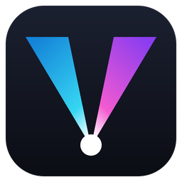

<p align="center">
  
</p>

<h1 align="center">VertexAV Director</h1>
<p align="center">
  <strong>Lighting that follows the music on its own, and a show that works in any venue.</strong><br/>
  Based on the <a href="https://www.qlcplus.org/">Q Light Controller Plus (QLC+)</a> engine.
</p>

<p align="center">
  <a href="CHANGELOG.md"></a>
  <a href="https://github.com/AdanRuiz/qlcplus/actions/workflows/build.yml">
    </a>
  <a href="COPYING"></a>
  
</p>

---

VertexAV Director describes a stage in terms of roles (front wash, moving heads, bars, strobes...) and then runs the show by itself, deciding scene, colour and movement from what the music is doing. The same show is reused in another venue by describing that venue, not by programming it again.

It is not stable yet: until 1.0.0 a new version may still break compatibility.

## What it does

- **The Director.** Listens to the music (tempo, song section, intensity, palette) and chooses what runs on four layers: base colour, movement, rhythm and accents. No cue list to program.
- **Stage Wizard.** Groups the fixtures by role, places them on a 3D stage and generates the looks the Director works with.
- **Rules in a text file.** What runs in each section is a `<project>.director.json` file next to the project. Edit it and save: the Director reads it again while the show runs, with no restart.
- **Overrides for the operator.** Force a section, an intensity or a colour, hold the look, black out, allow or block strobes and lasers, from a panel or from the same text file.
- **VertexAV Link.** The input plugin that brings the musical information in, from a DJ application that publishes it.
- **Demonstration mode.** Watch the Director work in the 3D view with no music, no fixtures and no sender.
- **Everything QLC+ does.** Fixture definitions, DMX output, plugins, functions, the virtual console and the workspace format (`.qxw`) come from QLC+ and stay compatible with it.

## Documentation

- Guide to the Director: [docs/director.md](docs/director.md)
- Plan and roadmap: [docs/PLAN-venues-director.md](docs/PLAN-venues-director.md)
- Changes by version: [CHANGELOG.md](CHANGELOG.md)

## Getting it

There is no public release yet. Every push builds a Windows installer in [GitHub Actions](https://github.com/AdanRuiz/qlcplus/actions/workflows/build.yml), kept as an artifact of the run. It installs next to QLC+ without touching it: settings, cache and file associations are separate, while project files, fixture definitions and the user data folder are shared.

## Building

VertexAV Director is the QML interface of QLC+ 5, built with CMake and Qt 6:

```
cmake -S . -B build -G Ninja -DCMAKE_BUILD_TYPE=Release -Dqmlui=ON -Dtests=OFF
ninja -C build
```

Platform specific instructions are the ones of QLC+, in its [GitHub Wiki](https://github.com/mcallegari/qlcplus/wiki). The checks of the Director run with `qmlui/director/test/run-tests.sh`.

## Versions

Versions are numbered `X.Y.Z`: **X** breaks compatibility, **Y** adds functionality, **Z** only fixes bugs. Every change is listed in [CHANGELOG.md](CHANGELOG.md).

## Built on QLC+

<a href="https://www.qlcplus.org/">
  
</a>

VertexAV Director is a derivative work of [Q Light Controller Plus](https://github.com/mcallegari/qlcplus), by Massimo Callegari, Heikki Junnila and [many contributors](https://github.com/mcallegari/qlcplus/graphs/contributors), and is distributed under the same [Apache 2.0 license](COPYING).

It is not an official QLC+ release and is not endorsed by the QLC+ project; see [NOTICE](NOTICE) for what was changed. For lighting control without the Director, for support with the engine and to support its authors, go to [qlcplus.org](https://www.qlcplus.org/).

## License

Licensed under the **Apache 2.0** License. See [COPYING](COPYING) for details.
