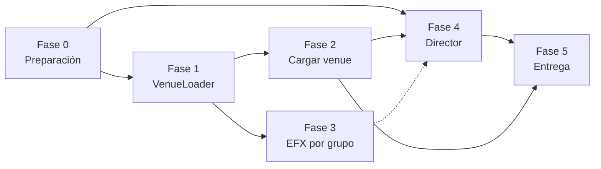

# Plan: venues portables y Director automático para QLC+

Fecha: 2026-11-13 · Rama de trabajo: `vertexav-link-5.3.0` · Estado: planeación

## 1. Objetivo

Que un mismo show reaccione solo a la música y funcione en cualquier lugar sin reprogramarlo. Hoy QLC+ necesita dos cosas para eso y solo tiene la mitad de cada una.

| Necesidad | Lo que ya existe | Lo que falta |
| --- | --- | --- |
| Funciones que no dependan del fixture | Scene con grupos y paletas, RGB Matrix por grupo | Cambiar el rig sin editar a mano; EFX por grupo |
| Que la música decida qué corre | Plugin VertexAV: tempo, sección, intensidad, mood y paleta como canales | Algo que convierta esos canales en funciones corriendo |
| Funciones básicas listas para usar | Stage Wizard de QLC+ 5.3: roles, escenas por grupo y paleta, EFX, matrices, chasers y colocación en 3D | Que el Director sepa qué es cada una |

### Mínimo viable

Montar el rig, pasar el Stage Wizard con la opción de Director y ver el show funcionando solo, primero simulado en la vista 3D. No necesita venues, ni EFX por grupo, ni cambios al motor, ni la aprobación del autor.

| Paso | Tarea | Qué aporta |
| --- | --- | --- |
| 1 | [F4-1](https://github.com/AdanRuiz/qlcplus/issues/31) | Diseño del Director: estado musical, capas y reglas |
| 2 | [F4-2](https://github.com/AdanRuiz/qlcplus/issues/32) | DirectorManager: escuchar los canales de VertexAV |
| 3 | [F4-3](https://github.com/AdanRuiz/qlcplus/issues/33) | Motor de decisión: elegir y cambiar looks |
| 4 | [F4-4](https://github.com/AdanRuiz/qlcplus/issues/34) | Guardar las reglas en el proyecto |
| 5 | [F4-5](https://github.com/AdanRuiz/qlcplus/issues/35) | Paleta de VertexAV a paletas de color de QLC+ |
| 6 | [F4-6](https://github.com/AdanRuiz/qlcplus/issues/36) | Panel del Director en vivo |
| 7 | [F4-12](https://github.com/AdanRuiz/qlcplus/issues/42) | Simulador de entrada y pruebas del Director |
| 8 | [F4-16](https://github.com/AdanRuiz/qlcplus/issues/51) | Manifiesto de lo que genera el Stage Wizard |
| 9 | [F4-17](https://github.com/AdanRuiz/qlcplus/issues/52) | Reglas por defecto a partir del manifiesto |
| 10 | [F4-18](https://github.com/AdanRuiz/qlcplus/issues/53) | Arranque en un paso: opción «Director automático» en el wizard |
| 11 | [F4-19](https://github.com/AdanRuiz/qlcplus/issues/54) | Modo demostración: simular el show en la vista 3D |

### Catálogo de funciones básicas

Lo que el Stage Wizard ya genera y cómo lo usaría el Director. La asignación a capas e intensidades es la propuesta de `F4-17`. La columna «Portable» sale de leer `qmlui/stagewizard/stagewizard_functions.cpp`: lo no portable se regenera con el wizard en cada rig (`F4-20`).

| Familia del wizard | Funciones | Capa del Director | Intensidad | Portable |
| --- | --- | --- | --- | --- |
| Color | Escenas de color por grupo y paleta | Base | todas | Sí |
| Color | Color Rainbow, Split Color (chasers) | Ritmo | medium, high | No: valores crudos, se regeneran |
| Intensity | Niveles de dimmer y shutter por grupo y paleta | Base | low, medium | Sí |
| Intensity | Blinder Hit | Acento | peak, cuentas regresivas | Sí |
| Intensity | Heartbeat | Ritmo | low, medium | No: valores crudos, se regeneran |
| Intensity | Strobe Chase | Acento | high, peak, con strobe permitido | No: valores crudos, se regeneran |
| Movement | Position Presets | Movimiento | low, medium | Sí |
| Movement | Circle Chase, Figure Eight, Audience Sweep (EFX) | Movimiento | medium a peak | No: lista de fixtures, se regeneran |
| Movement | Fly In, Fly Out (EFX) | Acento | entrada y salida de drop | No: lista de fixtures, se regeneran |
| Matrix | Pixel Chase, Wave, Marquee | Ritmo | medium, high | Sí |
| Matrix | Fireworks, Plasma | Ritmo | high, peak | Sí |
| Show Cues | Ambient Loop | Base | silencio y reposo | No: valores crudos, se regeneran |

Total: 56 tareas en 6 fases. 25 Must, 20 Should, 11 Could.

## 2. Arquitectura

```
  Emisor VertexAV (análisis de audio, fuera de QLC+)
        │  protocolo VertexAV Link
        ▼
┌──────────────────────┐   canales de entrada   ┌──────────────────────────┐
│ Plugin VertexAV      │ ─────────────────────▶ │ CAPA 3 · Director        │
│ (existe)             │   beat, sección,       │ reglas → función por capa│
└──────────────────────┘   intensidad, paleta   └────────────┬─────────────┘
                                                             │ arranca y para
                                                             ▼
                                                ┌──────────────────────────┐
                                                │ CAPA 2 · Funciones       │
                                                │ portables: Scene, Matrix,│
                                                │ EFX por grupo, Chaser    │
                                                └────────────┬─────────────┘
                                                             │ referencian roles
                                                             ▼
┌──────────────────────┐   Cargar venue         ┌──────────────────────────┐
│ Venue (.qxw reducido)│ ─────────────────────▶ │ CAPA 1 · Roles           │
│ fixtures + grupos    │   VenueLoader          │ FixtureGroup → fixtures  │
└──────────────────────┘                        └────────────┬─────────────┘
                                                             ▼
                                                          DMX
```

| Capa | Dónde vive | Cambia el formato `.qxw` | Va al autor |
| --- | --- | --- | --- |
| 1 · Roles y venues | `engine/src/venueloader`, `qmlui/venuemanager` | No | Sí, tras discutirlo |
| 2 · EFX por grupo | `engine/src/efx` | Sí, aditivo y con guardado dual | Solo si lo acepta |
| 3 · Director | `qmlui/directormanager` | Sí, bloque `<Director>` aditivo | No en esta ronda |

## 3. Fases y dependencias

| Fase | Objetivo | Tareas | Must | Should | Could |
| --- | --- | --- | --- | --- | --- |
| Fase 0 · Preparación | Dejar listo el terreno: ramas, discusión con el autor, convenciones y CI. | 6 | 4 | 2 | 0 |
| Fase 1 · Motor: VenueLoader | Cambiar el rig de un proyecto conservando funciones, sin tocar el formato .qxw. | 9 | 5 | 2 | 2 |
| Fase 2 · Interfaz: Cargar venue | Exponer la fase 1 en la interfaz QML con informe previo y emparejado de roles. | 9 | 3 | 4 | 2 |
| Fase 3 · EFX por grupo | Hacer portable el movimiento: EFX que referencia un grupo en vez de fixtures. | 6 | 0 | 5 | 1 |
| Fase 4 · Director automático | Decidir qué función corre en cada rol a partir de los canales de VertexAV. | 21 | 11 | 6 | 4 |
| Fase 5 · Entrega | Documentación, prueba de extremo a extremo y pull requests al autor. | 5 | 2 | 1 | 2 |



La fase 4 puede empezar en paralelo con la 1: `F4-1`, `F4-2` y `F4-5` no dependen de los venues. La línea punteada indica que el Director funciona sin EFX por grupo, pero sin movimiento portable.

El mínimo viable vive entero en la fase 4 y está marcado con la etiqueta `mvp`. Las fases 1 a 3 añaden después la portabilidad entre lugares.

## 4. Priorización MoSCoW

### Must (25): sin esto no hay producto

| Tarea | Fase | Título | Tamaño |
| --- | --- | --- | --- |
| [F0-1](https://github.com/AdanRuiz/qlcplus/issues/1) | 0 | Separar ramas: venues desde upstream/master, VertexAV aparte | S |
| [F0-2](https://github.com/AdanRuiz/qlcplus/issues/2) | 0 | Abrir la discusión con el autor en el foro de desarrollo | S |
| [F0-4](https://github.com/AdanRuiz/qlcplus/issues/4) | 0 | Definir el vocabulario estándar de roles | S |
| [F0-5](https://github.com/AdanRuiz/qlcplus/issues/5) | 0 | Crear los proyectos de prueba: un show portable y dos venues | M |
| [F1-1](https://github.com/AdanRuiz/qlcplus/issues/7) | 1 | Clasificar las funciones por portabilidad | M |
| [F1-2](https://github.com/AdanRuiz/qlcplus/issues/8) | 1 | Leer el venue y emparejar grupos por nombre | M |
| [F1-3](https://github.com/AdanRuiz/qlcplus/issues/9) | 1 | Generar el informe previo a la carga | M |
| [F1-4](https://github.com/AdanRuiz/qlcplus/issues/10) | 1 | Aplicar el venue: reemplazar fixtures y rellenar grupos | L |
| [F1-6](https://github.com/AdanRuiz/qlcplus/issues/12) | 1 | Pruebas unitarias de VenueLoader | M |
| [F2-1](https://github.com/AdanRuiz/qlcplus/issues/16) | 2 | VenueManager: puente entre VenueLoader y QML | M |
| [F2-2](https://github.com/AdanRuiz/qlcplus/issues/17) | 2 | Acción «Cargar venue» y diálogo de informe | M |
| [F2-5](https://github.com/AdanRuiz/qlcplus/issues/20) | 2 | Proteger el proyecto original al cargar un venue | S |
| [F4-1](https://github.com/AdanRuiz/qlcplus/issues/31) | 4 | Diseño del Director: estado musical, capas y reglas | M |
| [F4-2](https://github.com/AdanRuiz/qlcplus/issues/32) | 4 | DirectorManager: escuchar los canales de VertexAV | M |
| [F4-3](https://github.com/AdanRuiz/qlcplus/issues/33) | 4 | Motor de decisión: elegir y cambiar looks | L |
| [F4-4](https://github.com/AdanRuiz/qlcplus/issues/34) | 4 | Guardar las reglas en el proyecto | M |
| [F4-5](https://github.com/AdanRuiz/qlcplus/issues/35) | 4 | Paleta de VertexAV a paletas de color de QLC+ | M |
| [F4-6](https://github.com/AdanRuiz/qlcplus/issues/36) | 4 | Panel del Director en vivo | M |
| [F4-12](https://github.com/AdanRuiz/qlcplus/issues/42) | 4 | Simulador de entrada y pruebas del Director | M |
| [F4-16](https://github.com/AdanRuiz/qlcplus/issues/51) | 4 | Manifiesto de lo que genera el Stage Wizard | M |
| [F4-17](https://github.com/AdanRuiz/qlcplus/issues/52) | 4 | Reglas por defecto a partir del manifiesto | M |
| [F4-18](https://github.com/AdanRuiz/qlcplus/issues/53) | 4 | Arranque en un paso: opción «Director automático» en el wizard | M |
| [F4-19](https://github.com/AdanRuiz/qlcplus/issues/54) | 4 | Modo demostración: simular el show en la vista 3D | M |
| [F5-1](https://github.com/AdanRuiz/qlcplus/issues/46) | 5 | Prueba de extremo a extremo en dos venues | L |
| [F5-2](https://github.com/AdanRuiz/qlcplus/issues/47) | 5 | Documentación de usuario | M |

### Should (20): importante, pero hay rodeo temporal

| Tarea | Fase | Título | Tamaño |
| --- | --- | --- | --- |
| [F0-3](https://github.com/AdanRuiz/qlcplus/issues/3) | 0 | Búsqueda de patentes por titular antes de publicar el Director | S |
| [F0-6](https://github.com/AdanRuiz/qlcplus/issues/6) | 0 | CI del fork: ejecutar las pruebas del motor | M |
| [F1-5](https://github.com/AdanRuiz/qlcplus/issues/11) | 1 | Convertir valores crudos con FixtureRemapper | M |
| [F1-7](https://github.com/AdanRuiz/qlcplus/issues/13) | 1 | No tocar los fixtures que no cambian | M |
| [F2-3](https://github.com/AdanRuiz/qlcplus/issues/18) | 2 | Emparejado manual de roles | M |
| [F2-4](https://github.com/AdanRuiz/qlcplus/issues/19) | 2 | Indicador de portabilidad en el gestor de funciones | M |
| [F2-6](https://github.com/AdanRuiz/qlcplus/issues/21) | 2 | Widgets de la consola virtual que apuntan a fixtures | M |
| [F2-9](https://github.com/AdanRuiz/qlcplus/issues/24) | 2 | Textos traducibles y traducción al español | S |
| [F3-1](https://github.com/AdanRuiz/qlcplus/issues/25) | 3 | EFX: referencia a grupo y resolución al arrancar | L |
| [F3-2](https://github.com/AdanRuiz/qlcplus/issues/26) | 3 | Guardado dual: grupo más lista ya resuelta | M |
| [F3-3](https://github.com/AdanRuiz/qlcplus/issues/27) | 3 | Reparto automático del desfase en el grupo | M |
| [F3-4](https://github.com/AdanRuiz/qlcplus/issues/28) | 3 | Editor de EFX: destino por grupo | M |
| [F3-5](https://github.com/AdanRuiz/qlcplus/issues/29) | 3 | Pruebas de EFX por grupo | M |
| [F4-7](https://github.com/AdanRuiz/qlcplus/issues/37) | 4 | Editor de reglas | L |
| [F4-8](https://github.com/AdanRuiz/qlcplus/issues/38) | 4 | Reglas por defecto y etiquetado por carpetas | M |
| [F4-9](https://github.com/AdanRuiz/qlcplus/issues/39) | 4 | Acentos: cuentas regresivas, strobe permitido y silencio | M |
| [F4-10](https://github.com/AdanRuiz/qlcplus/issues/40) | 4 | Transiciones de mezcla entre canciones | M |
| [F4-20](https://github.com/AdanRuiz/qlcplus/issues/55) | 4 | Regenerar las funciones básicas al cargar un venue | M |
| [F4-21](https://github.com/AdanRuiz/qlcplus/issues/56) | 4 | Panel de overrides del Director | L |
| [F5-3](https://github.com/AdanRuiz/qlcplus/issues/48) | 5 | Pull requests al autor: VenueLoader e interfaz | M |

### Could (11): mejora si sobra tiempo

| Tarea | Fase | Título | Tamaño |
| --- | --- | --- | --- |
| [F1-8](https://github.com/AdanRuiz/qlcplus/issues/14) | 1 | Patch de E/S y monitor del venue como opciones | M |
| [F1-9](https://github.com/AdanRuiz/qlcplus/issues/15) | 1 | Corrección de pan y tilt por venue | L |
| [F2-7](https://github.com/AdanRuiz/qlcplus/issues/22) | 2 | Exportar el venue desde el proyecto actual | S |
| [F2-8](https://github.com/AdanRuiz/qlcplus/issues/23) | 2 | Lista de venues recientes | S |
| [F3-6](https://github.com/AdanRuiz/qlcplus/issues/30) | 3 | EFX por grupo en modos dimmer y RGB | M |
| [F4-11](https://github.com/AdanRuiz/qlcplus/issues/41) | 4 | Pack de looks portable de ejemplo | L |
| [F4-13](https://github.com/AdanRuiz/qlcplus/issues/43) | 4 | Variedad: no repetir looks | M |
| [F4-14](https://github.com/AdanRuiz/qlcplus/issues/44) | 4 | Control manual desde la consola virtual y disparadores | M |
| [F4-15](https://github.com/AdanRuiz/qlcplus/issues/45) | 4 | Usar el mood para elegir entre candidatas | S |
| [F5-4](https://github.com/AdanRuiz/qlcplus/issues/49) | 5 | Pull request al autor: EFX por grupo | M |
| [F5-5](https://github.com/AdanRuiz/qlcplus/issues/50) | 5 | Compilar el plugin y el Director en Linux y macOS | M |

### Won't (6): fuera de esta ronda, a propósito

| Qué | Por qué no |
| --- | --- |
| Generar el show completo de una canción sin escucharla en vivo (línea de tiempo por pista) | El análisis vive en VertexAV, no en QLC+. Es además la zona con más riesgo de patentes. |
| Soporte en la interfaz clásica de QLC+ 4 (`ui/`) | Duplica todo el trabajo de interfaz. El motor compartido sí queda cubierto. |
| Importar proyectos, fixtures o shows de otros programas de iluminación | Riesgo legal y formatos no documentados. |
| Convertir automáticamente escenas crudas en paletas | Adivinar la intención de un valor DMX es poco fiable; se ofrece el remapeo en su lugar. |
| Direcciones DMX solapadas o soft patch a nivel de universo | El autor lo rechazó en 2018 y el PR #469 lleva abierto desde 2015. |
| Director dentro del motor de QLC+ o propuesto al autor | Primero tiene que demostrar su valor en el fork. |

Los Won't no tienen issue. Tamaños: S hasta 1 día, M de 2 a 4 días, L de 1 a 2 semanas; son estimaciones sin medir.

## 5. Mockups

Los números y nombres de los mockups son ilustrativos.

### M1 · Diálogo «Cargar venue» con informe previo

Tarea: [F2-2](https://github.com/AdanRuiz/qlcplus/issues/17)

```
┌─ Cargar venue ─────────────────────────────────────────────────────────┐
│ Venue: Club_Norte.qxw                                   [ Cambiar… ]   │
│ 14 fixtures · 5 grupos · 2 universos                                   │
├────────────────────────────────────────────────────────────────────────┤
│ ROLES                              proyecto      venue                 │
│  ✔ Movers                          4 cabezas  →  6 cabezas             │
│  ✔ Front wash                      8 cabezas  →  4 cabezas             │
│  ✔ Pixel bar                       2 × 16     →  1 × 32                │
│  ⚠ Blinders                        2 cabezas  →  sin grupo             │
│                                                    [ Emparejar… ]      │
│  · Haze (solo en el venue)         sin uso en el proyecto              │
├────────────────────────────────────────────────────────────────────────┤
│ FUNCIONES                                                              │
│  ✔ 42 portables          se conservan sin cambios                      │
│  ↻  7 convertibles       valores crudos, se remapean por orden         │
│  ✖  3 no convertibles    quedarán vacías               [ Ver lista ]   │
│ CONSOLA VIRTUAL                                                        │
│  ⚠  2 widgets apuntan a fixtures directos              [ Ver lista ]   │
│ SIMPLE DESK                                                            │
│  ⚠  no se convierte                                                    │
├────────────────────────────────────────────────────────────────────────┤
│ ☑ Usar el patch de E/S del venue   ☑ Usar el monitor 2D/3D del venue   │
│ El archivo del proyecto no cambia hasta que guardes.                   │
│                             [ Cancelar ]   [ Cargar y guardar como… ]  │
└────────────────────────────────────────────────────────────────────────┘
```

### M2 · Emparejado manual de roles

Tarea: [F2-3](https://github.com/AdanRuiz/qlcplus/issues/18)

```
┌─ Emparejar roles ──────────────────────────────────────────────────────┐
│ Rol del proyecto        Grupo del venue                   Estado       │
│ ──────────────────────  ────────────────────────────────  ───────────  │
│ Movers                  [ Movers                     ▾ ]  automático   │
│ Front wash              [ Front wash                 ▾ ]  automático   │
│ Pixel bar               [ Pixel bar                  ▾ ]  automático   │
│ Blinders                [ Audience blinders          ▾ ]  manual       │
│ Strobes                 [ (ninguno: dejar vacío)     ▾ ]  sin grupo    │
│                                                                        │
│ Los roles sin grupo quedan vacíos; sus funciones no se borran.         │
│                                        [ Cancelar ]   [ Aceptar ]      │
└────────────────────────────────────────────────────────────────────────┘
```

### M3 · Indicador de portabilidad en el gestor de funciones

Tarea: [F2-4](https://github.com/AdanRuiz/qlcplus/issues/19)

```
┌─ Funciones ──────────────────────────────── Filtro: [ Todas       ▾ ] ─┐
│ ▾ Director                                                             │
│   ▾ peak                                                               │
│      ● Drop rojo                 Scene        grupos + paletas         │
│      ● Barrido pixel             RGB Matrix   grupo «Pixel bar»        │
│      ● Círculo movers            EFX          grupo «Movers»           │
│ ▾ Sueltas                                                              │
│      ◐ Wash ámbar viejo          Scene        12 valores crudos        │
│      ○ Secuencia intro           Sequence     96 valores crudos        │
│                                                                        │
│  ● portable    ◐ convertible al cargar un venue    ○ no portable       │
└────────────────────────────────────────────────────────────────────────┘
```

### M4 · Editor de EFX con destino por grupo

Tarea: [F3-4](https://github.com/AdanRuiz/qlcplus/issues/28)

```
┌─ EFX: Círculo movers ──────────────────────────────────────────────────┐
│ Destino    (•) Grupo  [ Movers                    ▾ ]   6 cabezas      │
│            ( ) Lista de fixtures                                       │
│                                                                        │
│ Reparto    Desfase total  [ 360° ]   Orden  [ Posición en el grupo ▾ ] │
│            Dirección      [ Adelante ▾ ]  ☐ Alternar por cabeza        │
│                                                                        │
│ Patrón     [ Circle ▾ ]  Ancho [127]  Alto [127]  Rotación [0]         │
│                                                                        │
│ Vista previa      1 ●      2 ●      3 ●      4 ●      5 ●      6 ●     │
│                   0°       60°      120°     180°     240°     300°    │
└────────────────────────────────────────────────────────────────────────┘
```

### M5 · Panel del Director en vivo

Tarea: [F4-6](https://github.com/AdanRuiz/qlcplus/issues/36)

```
┌─ Director ───────────────────────────────── [ ● AUTO ]  [ Editar… ] ───┐
│ Entrada   VertexAV · universo 2 · conectado                            │
│                                                                        │
│ Música    128 BPM   ▮ ▯ ▯ ▯    Sección  DROP     Intensidad  PEAK      │
│           Energía  ███████████████░░░  212       Mood  euphoric        │
│           Próximo cambio en 4 compases           Strobe  permitido     │
│                                                                        │
│ Paleta    ■ 1  ■ 2  ■ 3  ■ 4  □ 5  □ 6           → 4 paletas de color  │
│                                                                        │
│ Regla activa   «Drop peak»                                             │
│ Capa          Función en curso            Rol            Desde         │
│ ──────────    ────────────────────────    ───────────    ──────────    │
│ Base          Drop rojo                   Front wash     2 compases    │
│ Movimiento    Círculo movers              Movers         2 compases    │
│ Ritmo         Barrido pixel               Pixel bar      2 compases    │
│ Acento        Strobe blanco               Strobes        ahora         │
│                                                                        │
│ [ Mantener ]   [ Siguiente look ]   [ Blackout ]   [ Sin strobe ]      │
└────────────────────────────────────────────────────────────────────────┘
```

### M6 · Editor de reglas del Director

Tarea: [F4-7](https://github.com/AdanRuiz/qlcplus/issues/37)

```
┌─ Reglas del Director ──────────────────────────────────────────────────┐
│ Reglas (la más específica gana)      │ Regla: Drop peak                │
│ ──────────────────────────────────── │ ─────────────────────────────── │
│  1  Silencio            → blackout   │ Cuando                          │
│  2  Intro / Outro       → suave      │  Sección     ☑ drop  ☐ chorus   │
│  3  Verse               → medio      │  Intensidad  ☑ high  ☑ peak     │
│  4  Build               → subida     │  Mood        (cualquiera)       │
│ ▸5  Drop peak           → 4 capas    │                                 │
│  6  Breakdown           → ambiente   │ Entonces, por capa              │
│  7  (por defecto)       → medio      │  Base        Drop rojo, Drop    │
│                                      │              azul         [ + ] │
│ [ + Regla ]  [ Duplicar ]  [ Borrar ]│  Movimiento  Círculo movers [+] │
│                                      │  Ritmo       Barrido pixel  [+] │
│ [ Cargar reglas por defecto ]        │  Acento      Strobe blanco  [+] │
│                                      │              ☑ solo si strobe   │
│                                      │                está permitido   │
│                                      │ Rotar cada   [ 8 ] compases     │
│                                      │ Cambiar en   [ primer tiempo ▾] │
└────────────────────────────────────────────────────────────────────────┘
```

### M7 · Asignación de la paleta de VertexAV a paletas de QLC+

Tarea: [F4-5](https://github.com/AdanRuiz/qlcplus/issues/35)

```
┌─ Paleta de entrada ────────────────────────────────────────────────────┐
│ Color recibido     Canales       Paleta de QLC+ que se actualiza       │
│ ───────────────    ──────────    ────────────────────────────────────  │
│ ■ Color 1          50, 51, 52    [ Director · Primario            ▾ ]  │
│ ■ Color 2          53, 54, 55    [ Director · Secundario          ▾ ]  │
│ ■ Color 3          56, 57, 58    [ Director · Acento              ▾ ]  │
│ ■ Color 4          59, 60, 61    [ (sin asignar)                  ▾ ]  │
│ □ Color 5          62, 63, 64    [ (sin asignar)                  ▾ ]  │
│ □ Color 6          65, 66, 67    [ (sin asignar)                  ▾ ]  │
│                                                                        │
│ Aplicar cambios   [ en el siguiente compás ▾ ]   Fundido [ 1 beat ▾ ]  │
│ [ Crear las paletas que faltan ]                                       │
└────────────────────────────────────────────────────────────────────────┘
```

### M8 · Resumen del Stage Wizard con la opción de Director

Tarea: [F4-18](https://github.com/AdanRuiz/qlcplus/issues/53)

```
┌─ Show Wizard · 6 de 6 · Resumen ───────────────────────────────────────┐
│ Se va a generar                                                        │
│   4 grupos       Key (8) · Effect (6) · Strip (2) · Blinder (2)        │
│  38 escenas      color, dimmer, shutter y posición por grupo           │
│   9 efectos      3 EFX · 4 matrices · 2 chasers                        │
│   1 consola      páginas por grupo                                     │
│                                                                        │
│ ☑ Dejar que el Director orqueste el show                               │
│     Crea 3 paletas de color, 8 reglas por defecto y activa AUTO.       │
│     Entrada de música  [ VertexAV · universo 2                    ▾ ]  │
│                        [ Modo demostración (sin música)             ]  │
│ ☑ Abrir la vista 3D al terminar                                        │
│                                                                        │
│                                  [ Atrás ]   [ Cancelar ]  [ Generar ] │
└────────────────────────────────────────────────────────────────────────┘
```

### M9 · Modo demostración sobre la vista 3D

Tarea: [F4-19](https://github.com/AdanRuiz/qlcplus/issues/54)

```
┌─ Vista 3D ─────────────────────────────────────────────────────────────┐
│                                                                        │
│            ╲   │   ╱        ╲   │   ╱        ╲   │   ╱                 │
│        ─────●─────●─────●─────●─────●─────●─────   truss               │
│            ╱ ╲   ╱ ╲   ╱ ╲   ╱ ╲   ╱ ╲   ╱ ╲                           │
│           ╱   ╲ ╱   ╲ ╱   ╲ ╱   ╲ ╱   ╲ ╱   ╲                          │
│      ▓▓▓▓▓▓▓▓▓▓▓▓▓▓▓▓▓▓▓▓▓▓▓▓▓▓▓▓▓▓▓▓▓▓▓▓▓▓▓▓▓▓▓   escenario           │
│                                                                        │
├─ Demostración ─────────────────────────────────────────────────────────┤
│ [ ▶ ]  [ ❚❚ ]   BPM [ 128 ]   Intensidad [ ████████░░ ]  ☐ Enviar DMX  │
│ intro │ verse │ build │▓ DROP ▓│ breakdown │ build │ drop │ outro      │
│                        ▲ compás 3 de 8                                 │
│ Regla «Drop» · Base: Rojo · Movimiento: Circle Chase · Ritmo: Wave     │
└────────────────────────────────────────────────────────────────────────┘
```

### M10 · Panel de overrides del Director

Tarea: [F4-21](https://github.com/AdanRuiz/qlcplus/issues/56)

```
┌─ Director · Overrides ─────────────────── 3 activos  [ Liberar todo ] ─┐
│ MÚSICA                    lo que detecta        lo que usa             │
│  Sección      [ Auto ▾ ]  build                 build                  │
│  Intensidad   [ Peak ▾ ]  high                  PEAK         ● forzado │
│  BPM          [ Auto   ]  128                   128    [ Tap ] [ ÷2 ×2]│
│                                                                        │
│ CAPAS                     función               estado                 │
│  Base         [ Auto            ▾ ]  Drop rojo        [ Fijar ] [ Off ]│
│  Movimiento   [ Figure Eight    ▾ ]  Figure Eight   ● fijada  [ Off ]  │
│  Ritmo        [ Auto            ▾ ]  Wave             [ Fijar ] [ Off ]│
│  Acento       [ Auto            ▾ ]  —                [ Fijar ] [ Off ]│
│                                                                        │
│ COLOR         (•) De la música   ( ) Fijo  ■ ■ ■    [ Elegir… ]        │
│ ROLES         ☑ Key  ☑ Effect  ☑ Strip  ☐ Blinder  ● excluido          │
│                                                                        │
│ STROBES                                        ☑ Permitidos            │
│  Disparo     [ Mantener ]  [ 1 compás ]  [ Hasta el drop ]  ☐ Enclavar │
│  Velocidad   ( ) 1/4   (•) 1/8   ( ) 1/16   ( ) Libre [ 12 Hz ]        │
│  Tipo        [ Completo ▾ ]   completo · aleatorio · barrido · pulso   │
│  Color       (•) Blanco   ( ) Paleta de la música                      │
│  Roles       ☑ Key  ☑ Strip  ☑ Blinder  ☐ Effect    Nivel [ ████░ ]    │
│  Automático  (•) Si la música lo permite  ( ) Nunca  ( ) Solo manual   │
│  Límite      [ 8 ] segundos seguidos                                   │
│                                                                        │
│ Duración de un override  [ Hasta la siguiente sección ▾ ]              │
│                                                                        │
│ MOMENTÁNEOS (mientras se pulsa)                                        │
│ [ Blackout ]  [ Full on ]  [ Freeze ]  [ Blinder ]                     │
│ PERMISOS      ☑ Blinders   ☑ Humo   ☐ Cambios de look                  │
└────────────────────────────────────────────────────────────────────────┘
```

## 6. Formato de datos nuevo

La fase 1 no añade nada. Las fases 3 y 4 añaden estos dos bloques, ambos ignorados con un aviso por versiones anteriores.

EFX por grupo con guardado dual (fase 3):

```xml
<Function ID="12" Type="EFX" Name="Círculo movers">
  <FixtureGroup ID="3" Spread="360"/>   <!-- nuevo -->
  <Fixture><ID>40</ID><Head>0</Head><Mode>Position</Mode><Direction>Forward</Direction><StartOffset>0</StartOffset></Fixture>
  <Fixture><ID>41</ID><Head>0</Head><Mode>Position</Mode><Direction>Forward</Direction><StartOffset>60</StartOffset></Fixture>
  <Algorithm>Circle</Algorithm>
</Function>
```

Reglas del Director, hijo de `<Workspace>` (fase 4):

```xml
<Director Enabled="1" Universe="2" Idle="18">
  <PaletteSlot Index="1" Palette="12"/>
  <PaletteSlot Index="2" Palette="13"/>
  <Rule Name="Drop peak" Sections="drop" Intensities="high,peak" Bars="8">
    <Layer Name="Base">31,32</Layer>
    <Layer Name="Movement">40</Layer>
    <Layer Name="Rhythm">44</Layer>
    <Layer Name="Accent" StrobeOnly="1">55</Layer>
  </Rule>
  <Rule Name="Default" Bars="16">
    <Layer Name="Base">20</Layer>
  </Rule>
</Director>
```

Los nombres de etiquetas y atributos son una propuesta; se fijan en `F3-2` y `F4-4`.

## 7. Tareas por fase

### Fase 0 · Preparación

Dejar listo el terreno: ramas, discusión con el autor, convenciones y CI.

| Tarea | Prioridad | Tamaño | Título | Depende de |
| --- | --- | --- | --- | --- |
| [F0-1](https://github.com/AdanRuiz/qlcplus/issues/1) | Must | S | Separar ramas: venues desde upstream/master, VertexAV aparte | — |
| [F0-2](https://github.com/AdanRuiz/qlcplus/issues/2) | Must | S | Abrir la discusión con el autor en el foro de desarrollo | — |
| [F0-3](https://github.com/AdanRuiz/qlcplus/issues/3) | Should | S | Búsqueda de patentes por titular antes de publicar el Director | — |
| [F0-4](https://github.com/AdanRuiz/qlcplus/issues/4) | Must | S | Definir el vocabulario estándar de roles | — |
| [F0-5](https://github.com/AdanRuiz/qlcplus/issues/5) | Must | M | Crear los proyectos de prueba: un show portable y dos venues | [F0-4](https://github.com/AdanRuiz/qlcplus/issues/4) |
| [F0-6](https://github.com/AdanRuiz/qlcplus/issues/6) | Should | M | CI del fork: ejecutar las pruebas del motor | — |

#### F0-1 · Separar ramas: venues desde upstream/master, VertexAV aparte

Must · S (hasta 1 día)

La rama `vertexav-link-5.3.0` mezcla el plugin y el CI del fork y está 68 commits atrás de `upstream/master`. Lo que vaya al autor tiene que salir de ramas limpias.

Qué hay que hacer:

- Actualizar `master` del fork con `upstream/master`.
- Crear `venues/engine` desde `upstream/master` para la fase 1.
- Definir una rama de integración del fork (`vertexav-director`) que una venues, EFX por grupo, plugin y director.
- Escribir en el README del fork qué rama es para qué.

Criterios de aceptación:

- `git diff upstream/master...venues/engine` no incluye `plugins/vertexav` ni `.github/workflows`.
- La rama de integración compila en el CI del fork.

#### F0-2 · Abrir la discusión con el autor en el foro de desarrollo

Must · S (hasta 1 día)

`CONTRIBUTING.md` línea 21 exige discutir antes los cambios al motor. La idea ya se pidió en 2023 (hilo «programming everything with groups») sin respuesta del equipo.

Qué hay que hacer:

- Redactar la propuesta en inglés: venues como `.qxw` reducido, `VenueLoader` como clase nueva, EFX por grupo con guardado dual.
- Citar el hilo de 2023 y el remapeo restaurado en QLC+ 5 como base.
- Plantear las cinco preguntas abiertas de la especificación.
- Describir la función en sus propios términos, sin compararla con productos comerciales.

Criterios de aceptación:

- Hilo publicado y enlazado desde este issue.
- Respuesta del autor registrada aquí, o constancia de que no hubo respuesta tras 3 semanas.

#### F0-3 · Búsqueda de patentes por titular antes de publicar el Director

Should · S (hasta 1 día)

La reacción automática de luces a la música es la zona donde es más probable que existan patentes. Dos búsquedas web no encontraron ninguna de los fabricantes comerciales del sector, pero eso no es una revisión.

Qué hay que hacer:

- Buscar por titular y por palabras clave en Google Patents, USPTO y Espacenet.
- Anotar número, estado y reivindicaciones principales de lo que aparezca.
- Si aparece algo vigente y cercano, consultarlo con un abogado antes de distribuir la fase 4.

Criterios de aceptación:

- Tabla de resultados adjunta a este issue.
- Decisión escrita: se publica la fase 4, se ajusta el diseño, o se consulta.

#### F0-4 · Definir el vocabulario estándar de roles

Must · S (hasta 1 día)

Los venues se emparejan con el proyecto por nombre de grupo. Sin nombres acordados cada venue necesita emparejado manual.

Qué hay que hacer:

- Adoptar los nueve roles que ya define el Stage Wizard del autor (`StageWizard::FixtureRole`): Key, Fill, Back, Side, Effect, Strip, Blinder, Hazer y Floor.
- Fijar el nombre de grupo que corresponde a cada rol, para que el emparejado por nombre funcione.
- Anotar qué capacidades detecta el wizard para cada rol (movimiento, RGB, CMY, rueda de color, gobo, shutter, dimmer).
- Documentar cómo nombrar roles propios sin chocar con los estándar.

Criterios de aceptación:

- Tabla de roles en la documentación del fork.
- El emparejado de la fase 1 usa estos nombres en sus pruebas.

#### F0-5 · Crear los proyectos de prueba: un show portable y dos venues

Must · M (2 a 4 días)

Todas las fases necesitan los mismos datos de prueba: un show hecho solo con grupos y paletas, y dos rigs distintos.

Qué hay que hacer:

- Crear `show_portable.qxw` con escenas por grupo y paleta, una RGB Matrix y un chaser.
- Crear `venue_a.qxw` y `venue_b.qxw` con fixtures distintos y los mismos nombres de rol.
- Añadir al show dos funciones no portables (una Scene cruda y un EFX) para probar el informe.
- Guardarlos en `resources/` de prueba o en `engine/test/venueloader/`.

Criterios de aceptación:

- Los tres archivos abren sin avisos en QLC+ 5.
- Venue B tiene distinto número de cabezas que Venue A en al menos dos roles.

#### F0-6 · CI del fork: ejecutar las pruebas del motor

Should · M (2 a 4 días)

El CI del fork solo compila Windows y sube la DLL. Los cambios al motor necesitan `make check` en cada push.

Qué hay que hacer:

- Añadir un job de Linux que compile el motor y ejecute las pruebas unitarias.
- Hacer que falle el workflow si falla una prueba.
- Mantener este cambio solo en el fork.

Criterios de aceptación:

- Un push con una prueba rota deja el workflow en rojo.
- El job tarda menos de 20 minutos.

Archivos: `.github/workflows/build.yml`

### Fase 1 · Motor: VenueLoader

Cambiar el rig de un proyecto conservando funciones, sin tocar el formato .qxw.

| Tarea | Prioridad | Tamaño | Título | Depende de |
| --- | --- | --- | --- | --- |
| [F1-1](https://github.com/AdanRuiz/qlcplus/issues/7) | Must | M | Clasificar las funciones por portabilidad | — |
| [F1-2](https://github.com/AdanRuiz/qlcplus/issues/8) | Must | M | Leer el venue y emparejar grupos por nombre | [F0-5](https://github.com/AdanRuiz/qlcplus/issues/5) |
| [F1-3](https://github.com/AdanRuiz/qlcplus/issues/9) | Must | M | Generar el informe previo a la carga | [F1-1](https://github.com/AdanRuiz/qlcplus/issues/7), [F1-2](https://github.com/AdanRuiz/qlcplus/issues/8) |
| [F1-4](https://github.com/AdanRuiz/qlcplus/issues/10) | Must | L | Aplicar el venue: reemplazar fixtures y rellenar grupos | [F1-3](https://github.com/AdanRuiz/qlcplus/issues/9) |
| [F1-5](https://github.com/AdanRuiz/qlcplus/issues/11) | Should | M | Convertir valores crudos con FixtureRemapper | [F1-4](https://github.com/AdanRuiz/qlcplus/issues/10) |
| [F1-6](https://github.com/AdanRuiz/qlcplus/issues/12) | Must | M | Pruebas unitarias de VenueLoader | [F1-4](https://github.com/AdanRuiz/qlcplus/issues/10) |
| [F1-7](https://github.com/AdanRuiz/qlcplus/issues/13) | Should | M | No tocar los fixtures que no cambian | [F1-4](https://github.com/AdanRuiz/qlcplus/issues/10) |
| [F1-8](https://github.com/AdanRuiz/qlcplus/issues/14) | Could | M | Patch de E/S y monitor del venue como opciones | [F1-4](https://github.com/AdanRuiz/qlcplus/issues/10) |
| [F1-9](https://github.com/AdanRuiz/qlcplus/issues/15) | Could | L | Corrección de pan y tilt por venue | [F1-4](https://github.com/AdanRuiz/qlcplus/issues/10), [F0-2](https://github.com/AdanRuiz/qlcplus/issues/2) |

#### F1-1 · Clasificar las funciones por portabilidad

Must · M (2 a 4 días)

El informe y el indicador de la interfaz necesitan saber qué funciones sobreviven a un cambio de rig.

Qué hay que hacer:

- Definir tres clases: portable, convertible (valores crudos remapeables) y no portable.
- Scene: portable si no tiene valores crudos; convertible si los tiene.
- RGB Matrix: portable. Chaser, Collection y Show: la peor clase de sus hijos.
- Sequence: convertible. EFX: convertible hasta la fase 3.
- Exponerlo como función estática consultable sin cargar ningún venue.

Criterios de aceptación:

- Prueba unitaria con un caso por tipo de función.
- Un Chaser con un paso no portable se clasifica como no portable.

Archivos: `engine/src/venueloader.h`, `engine/src/venueloader.cpp`

#### F1-2 · Leer el venue y emparejar grupos por nombre

Must · M (2 a 4 días)

El venue es un `.qxw` normal. Se abre en un `Doc` temporal, como ya hace `ImportManager`, y se emparejan sus grupos con los del proyecto.

Qué hay que hacer:

- Cargar solo la sección `<Engine>` del venue en un `Doc` temporal.
- Emparejar por nombre sin distinguir mayúsculas ni espacios sobrantes.
- Aceptar un mapa manual de emparejado que tenga prioridad sobre el automático.
- Rechazar con un error claro los archivos que no sean un proyecto de QLC+.

Criterios de aceptación:

- «movers» empareja con «Movers ».
- Dos grupos del venue con el mismo nombre producen un aviso y se usa el primero.
- Un `.qxf` o un archivo corrupto devuelve error sin modificar el proyecto.

Archivos: `engine/src/venueloader.cpp`

#### F1-3 · Generar el informe previo a la carga

Must · M (2 a 4 días)

Antes de aplicar nada el usuario tiene que ver qué va a pasar. Es la queja más repetida sobre el remapeo actual.

Qué hay que hacer:

- Definir la estructura `VenueReport`: roles emparejados con conteo de cabezas, roles sin grupo, grupos del venue sin uso.
- Incluir la lista de funciones por clase de portabilidad.
- Incluir un indicador de que existen escenas de Simple Desk, que no se convierten.
- No modificar el `Doc` del proyecto al generar el informe.

Criterios de aceptación:

- Generar el informe dos veces da el mismo resultado y el proyecto queda idéntico.
- El informe del show de prueba contra Venue B lista exactamente las dos funciones no portables.

Archivos: `engine/src/venueloader.h`

#### F1-4 · Aplicar el venue: reemplazar fixtures y rellenar grupos

Must · L (1 a 2 semanas)

Es el núcleo de la fase. Las funciones portables referencian IDs de grupo, así que basta con cambiar el contenido de cada grupo.

Qué hay que hacer:

- Llamar a `Doc::replaceFixtures` con los fixtures del venue.
- En cada grupo emparejado: `reset()`, tamaño del venue y `assignHead` con sus cabezas.
- Conservar los IDs y nombres de los grupos del proyecto.
- Dejar vacíos, sin borrar, los grupos sin pareja.
- Añadir al proyecto los grupos del venue que no existían, con ID nuevo.

Criterios de aceptación:

- Tras cargar Venue B, una Scene con grupo y paleta escribe valores en los fixtures de B.
- La RGB Matrix conserva su ID de grupo y usa el tamaño del grupo de B.
- Ninguna función cambia de ID ni se borra.

Archivos: `engine/src/venueloader.cpp`, `engine/src/doc.h`

#### F1-5 · Convertir valores crudos con FixtureRemapper

Should · M (2 a 4 días)

Las escenas y secuencias con valores por canal no son portables, pero se pueden convertir en el mejor esfuerzo reutilizando el remapeo del motor.

Qué hay que hacer:

- Emparejar las cabezas de cada par de grupos por orden de posición.
- Llamar a `FixtureRemapper::autoConnectFixtures` para cada par.
- Cuando el venue tiene menos cabezas, descartar las sobrantes y anotarlo en el informe.
- Cuando tiene más, dejar las nuevas sin valores.

Criterios de aceptación:

- Una Scene cruda sobre 4 movers se convierte completa a un venue con 4 movers de otro modelo.
- Con 2 movers en el venue se convierten 2 y el informe nombra las 2 descartadas.

Archivos: `engine/src/venueloader.cpp`, `engine/src/fixtureremapper.h`

#### F1-6 · Pruebas unitarias de VenueLoader

Must · M (2 a 4 días)

El autor exige `make check` sin regresiones. El modelo es `engine/test/fixtureremapper`.

Qué hay que hacer:

- Crear `engine/test/venueloader/` y registrarlo en CMake.
- Cubrir emparejado, informe, aplicación, grupos sin pareja y conversión de valores crudos.
- Probar que guardar y reabrir tras cargar un venue da el mismo `Doc`.
- Probar que el archivo guardado no contiene etiquetas nuevas.

Criterios de aceptación:

- Las pruebas pasan en Linux y Windows.
- Cobertura de `venueloader.cpp` por encima del 85 %.

Archivos: `engine/test/venueloader/`, `engine/test/CMakeLists.txt`

#### F1-7 · No tocar los fixtures que no cambian

Should · M (2 a 4 días)

Si el venue comparte fixtures con el proyecto (mismo modelo, modo y dirección), reemplazarlos pierde modificadores de canal y ajustes sin necesidad.

Qué hay que hacer:

- Detectar fixtures idénticos por definición, modo, universo y dirección.
- Conservar su ID y su configuración.
- Mostrar en el informe cuántos se conservan.

Criterios de aceptación:

- Cargar el mismo venue dos veces no cambia nada.
- Un fixture idéntico conserva sus modificadores de canal.

#### F1-8 · Patch de E/S y monitor del venue como opciones

Could · M (2 a 4 días)

Cada lugar tiene sus interfaces DMX y su disposición física. Tiene sentido que viajen con el venue, pero el usuario debe poder decir que no.

Qué hay que hacer:

- Opción para reemplazar el mapa de E/S por el del venue.
- Opción para reemplazar las propiedades del monitor 2D y 3D.
- Por defecto: monitor sí, E/S sí, salvo la entrada de VertexAV que se conserva.

Criterios de aceptación:

- Con las opciones apagadas el mapa de E/S queda intacto.
- La entrada de VertexAV sigue asignada tras cargar un venue.

#### F1-9 · Corrección de pan y tilt por venue

Could · L (1 a 2 semanas)

Las paletas de posición guardan ángulos. En otro escenario los mismos ángulos apuntan a otro sitio. Un moderador del foro apoyó un desfase por grupo en 2023.

Qué hay que hacer:

- Decidir dónde se guarda: desfase por grupo en el venue o paletas de posición propias del venue.
- Aplicar el desfase al resolver paletas de posición.
- Requiere una etiqueta nueva: acordarla con el autor antes de implementar.

Criterios de aceptación:

- Una paleta «centro del escenario» apunta al centro en los dos venues de prueba.
- Sin desfase definido el comportamiento es el actual.

### Fase 2 · Interfaz: Cargar venue

Exponer la fase 1 en la interfaz QML con informe previo y emparejado de roles.

| Tarea | Prioridad | Tamaño | Título | Depende de |
| --- | --- | --- | --- | --- |
| [F2-1](https://github.com/AdanRuiz/qlcplus/issues/16) | Must | M | VenueManager: puente entre VenueLoader y QML | [F1-4](https://github.com/AdanRuiz/qlcplus/issues/10) |
| [F2-2](https://github.com/AdanRuiz/qlcplus/issues/17) | Must | M | Acción «Cargar venue» y diálogo de informe | [F2-1](https://github.com/AdanRuiz/qlcplus/issues/16) |
| [F2-3](https://github.com/AdanRuiz/qlcplus/issues/18) | Should | M | Emparejado manual de roles | [F2-2](https://github.com/AdanRuiz/qlcplus/issues/17) |
| [F2-4](https://github.com/AdanRuiz/qlcplus/issues/19) | Should | M | Indicador de portabilidad en el gestor de funciones | [F1-1](https://github.com/AdanRuiz/qlcplus/issues/7) |
| [F2-5](https://github.com/AdanRuiz/qlcplus/issues/20) | Must | S | Proteger el proyecto original al cargar un venue | [F2-2](https://github.com/AdanRuiz/qlcplus/issues/17) |
| [F2-6](https://github.com/AdanRuiz/qlcplus/issues/21) | Should | M | Widgets de la consola virtual que apuntan a fixtures | [F1-5](https://github.com/AdanRuiz/qlcplus/issues/11), [F2-2](https://github.com/AdanRuiz/qlcplus/issues/17) |
| [F2-7](https://github.com/AdanRuiz/qlcplus/issues/22) | Could | S | Exportar el venue desde el proyecto actual | [F2-1](https://github.com/AdanRuiz/qlcplus/issues/16) |
| [F2-8](https://github.com/AdanRuiz/qlcplus/issues/23) | Could | S | Lista de venues recientes | [F2-2](https://github.com/AdanRuiz/qlcplus/issues/17) |
| [F2-9](https://github.com/AdanRuiz/qlcplus/issues/24) | Should | S | Textos traducibles y traducción al español | [F2-2](https://github.com/AdanRuiz/qlcplus/issues/17) |

#### F2-1 · VenueManager: puente entre VenueLoader y QML

Must · M (2 a 4 días)

La interfaz QML habla con clases de contexto como `FixtureRemapManager`. Hace falta la equivalente para venues.

Qué hay que hacer:

- Crear `qmlui/venuemanager.{h,cpp}` y registrarla en `App`.
- Exponer: elegir archivo, obtener el informe como modelo, fijar emparejados manuales, aplicar.
- Refrescar los árboles de fixtures, grupos y funciones al terminar.

Criterios de aceptación:

- Tras aplicar, el gestor de fixtures muestra los del venue sin reiniciar.
- Cancelar deja el proyecto sin cambios.

Archivos: `qmlui/venuemanager.h`, `qmlui/venuemanager.cpp`, `qmlui/app.cpp`

#### F2-2 · Acción «Cargar venue» y diálogo de informe

Must · M (2 a 4 días) · mockup M1

Punto de entrada de la función. El informe es también la confirmación.

Qué hay que hacer:

- Añadir la acción junto a «Remap fixtures» en el gestor de fixtures.
- Mostrar roles, funciones y consola virtual como en el mockup.
- Botones «Ver lista» que abren el detalle de funciones y widgets afectados.
- El botón principal aplica y abre «Guardar como».

Criterios de aceptación:

- Con el show de prueba y Venue B el diálogo muestra los conteos correctos.
- No se puede aplicar sin haber visto el informe.

Archivos: `qmlui/qml/fixturesfunctions/`

#### F2-3 · Emparejado manual de roles

Should · M (2 a 4 días) · mockup M2

Los nombres no siempre coinciden. Hay que poder corregirlo sin editar el archivo del venue.

Qué hay que hacer:

- Tabla con un desplegable por rol del proyecto.
- Opción explícita «ninguno: dejar vacío».
- Actualizar el informe al cambiar un emparejado.

Criterios de aceptación:

- Asignar «Audience blinders» a «Blinders» quita el aviso del informe.
- Un grupo del venue no se puede asignar a dos roles.

#### F2-4 · Indicador de portabilidad en el gestor de funciones

Should · M (2 a 4 días) · mockup M3

Para construir un show portable hay que ver, mientras se programa, qué funciones no lo son.

Qué hay que hacer:

- Icono de tres estados por función, con el motivo en el texto de ayuda.
- Filtro para mostrar solo las no portables.
- Recalcular al editar la función.

Criterios de aceptación:

- Añadir un valor crudo a una Scene cambia su icono al momento.
- El filtro muestra exactamente las funciones que el informe lista como no portables.

#### F2-5 · Proteger el proyecto original al cargar un venue

Must · S (hasta 1 día)

En el foro se reporta que tras remapear se pierde el archivo original. Cargar un venue no debe poder pisarlo por accidente.

Qué hay que hacer:

- Tras aplicar, marcar el proyecto como modificado y sin nombre de archivo.
- Proponer como nombre `<proyecto> @ <venue>.qxw`.
- Avisar si el usuario intenta guardar sobre el original.

Criterios de aceptación:

- «Guardar» tras cargar un venue abre «Guardar como».
- El archivo original queda idéntico byte a byte.

#### F2-6 · Widgets de la consola virtual que apuntan a fixtures

Should · M (2 a 4 días)

Sliders en modo nivel, XY pads y disparadores de audio referencian fixtures directos. El remapeo de QLC+ 5 ya sabe convertirlos.

Qué hay que hacer:

- Reutilizar el remapeo de widgets existente con el mapa de cabezas del venue.
- Listar en el informe los widgets que no se pudieron convertir.

Criterios de aceptación:

- Un XY pad sobre 4 movers controla los movers del venue tras cargar.
- Los widgets no convertidos aparecen en «Ver lista».

#### F2-7 · Exportar el venue desde el proyecto actual

Could · S (hasta 1 día)

La forma más fácil de crear un venue es partir del rig que ya está montado.

Qué hay que hacer:

- Acción «Guardar como venue»: escribe un `.qxw` con fixtures, grupos, E/S y monitor.
- No incluir funciones, paletas ni consola virtual.

Criterios de aceptación:

- El archivo exportado abre como proyecto normal.
- Cargarlo sobre el proyecto de origen no cambia nada.

#### F2-8 · Lista de venues recientes

Could · S (hasta 1 día)

En gira se alterna entre pocos lugares. Evita buscar el archivo cada vez.

Qué hay que hacer:

- Guardar las últimas rutas en la configuración de la aplicación.
- Mostrarlas en el diálogo de carga.

Criterios de aceptación:

- El último venue cargado aparece primero.
- Las rutas que ya no existen se muestran deshabilitadas.

#### F2-9 · Textos traducibles y traducción al español

Should · S (hasta 1 día)

QLC+ usa `tr()` y archivos `.ts`. Los textos nuevos deben poder traducirse.

Qué hay que hacer:

- Todos los textos nuevos con `tr()` o `qsTr()`.
- Actualizar los `.ts` y completar español.

Criterios de aceptación:

- No hay cadenas visibles sin traducir en español.
- `translate.sh` no reporta errores.

### Fase 3 · EFX por grupo

Hacer portable el movimiento: EFX que referencia un grupo en vez de fixtures.

| Tarea | Prioridad | Tamaño | Título | Depende de |
| --- | --- | --- | --- | --- |
| [F3-1](https://github.com/AdanRuiz/qlcplus/issues/25) | Should | L | EFX: referencia a grupo y resolución al arrancar | [F0-2](https://github.com/AdanRuiz/qlcplus/issues/2), [F1-4](https://github.com/AdanRuiz/qlcplus/issues/10) |
| [F3-2](https://github.com/AdanRuiz/qlcplus/issues/26) | Should | M | Guardado dual: grupo más lista ya resuelta | [F3-1](https://github.com/AdanRuiz/qlcplus/issues/25) |
| [F3-3](https://github.com/AdanRuiz/qlcplus/issues/27) | Should | M | Reparto automático del desfase en el grupo | [F3-1](https://github.com/AdanRuiz/qlcplus/issues/25) |
| [F3-4](https://github.com/AdanRuiz/qlcplus/issues/28) | Should | M | Editor de EFX: destino por grupo | [F3-3](https://github.com/AdanRuiz/qlcplus/issues/27) |
| [F3-5](https://github.com/AdanRuiz/qlcplus/issues/29) | Should | M | Pruebas de EFX por grupo | [F3-2](https://github.com/AdanRuiz/qlcplus/issues/26), [F3-3](https://github.com/AdanRuiz/qlcplus/issues/27) |
| [F3-6](https://github.com/AdanRuiz/qlcplus/issues/30) | Could | M | EFX por grupo en modos dimmer y RGB | [F3-1](https://github.com/AdanRuiz/qlcplus/issues/25) |

#### F3-1 · EFX: referencia a grupo y resolución al arrancar

Should · L (1 a 2 semanas)

EFX guarda una lista de fixtures y por eso no es portable. Fue pedido en el foro en 2023. Modifica una clase del motor: necesita el acuerdo del autor para ir a upstream.

Qué hay que hacer:

- Añadir a `EFX` un ID de grupo opcional.
- Al arrancar, construir la lista de `EFXFixture` con las cabezas del grupo que tengan pan y tilt.
- Reconstruirla cuando cambie el grupo.
- Sin grupo, el comportamiento es exactamente el actual.

Criterios de aceptación:

- Un EFX por grupo mueve los movers de Venue A y, tras cargar Venue B, los de B.
- Las pruebas existentes de EFX pasan sin cambios.

Archivos: `engine/src/efx.h`, `engine/src/efx.cpp`

#### F3-2 · Guardado dual: grupo más lista ya resuelta

Should · M (2 a 4 días)

Una versión antigua salta la etiqueta de grupo y vería el EFX vacío. Guardar también la lista resuelta lo evita; la idea viene de un hilo del foro sobre áreas de EFX.

Qué hay que hacer:

- Escribir `<FixtureGroup ID>` y además los `<Fixture>` resueltos.
- Al cargar, si hay grupo válido se usa el grupo; si no, la lista.
- Probar el archivo en QLC+ 5.3.0 sin modificar.

Criterios de aceptación:

- QLC+ 5.3.0 abre el archivo y el EFX se mueve con los fixtures guardados.
- La versión nueva ignora la lista cuando el grupo existe.

Archivos: `engine/src/efx.cpp`

#### F3-3 · Reparto automático del desfase en el grupo

Should · M (2 a 4 días)

Hoy el desfase se pone fixture por fixture. Con un grupo de tamaño variable tiene que calcularse solo.

Qué hay que hacer:

- Un parámetro de desfase total repartido entre las cabezas.
- Orden por posición en el grupo.
- Opción de alternar la dirección por cabeza.

Criterios de aceptación:

- Con 360° y 6 cabezas los desfases son 0, 60, 120, 180, 240 y 300.
- Cambiar el número de cabezas recalcula el reparto.

#### F3-4 · Editor de EFX: destino por grupo

Should · M (2 a 4 días) · mockup M4

La función del motor necesita su control en el editor.

Qué hay que hacer:

- Selector «Grupo» o «Lista de fixtures».
- Controles de reparto y vista previa de desfases.
- Conversión de un EFX existente a grupo cuando sus fixtures coinciden con uno.

Criterios de aceptación:

- Se puede crear un EFX por grupo sin tocar la lista de fixtures.
- La vista previa muestra un desfase por cabeza.

Archivos: `qmlui/efxeditor.cpp`, `qmlui/qml/fixturesfunctions/`

#### F3-5 · Pruebas de EFX por grupo

Should · M (2 a 4 días)

Cambio en una clase central: sin pruebas no es presentable al autor.

Qué hay que hacer:

- Ampliar `engine/test/efx` con resolución por grupo, guardado dual y reparto.
- Probar grupo borrado, grupo vacío y grupo sin cabezas con pan y tilt.

Criterios de aceptación:

- Un grupo borrado deja el EFX usando la lista guardada, sin fallar.
- Todas las pruebas de EFX pasan.

Archivos: `engine/test/efx/`

#### F3-6 · EFX por grupo en modos dimmer y RGB

Could · M (2 a 4 días)

EFX también puede modular dimmer y color. Extiende el grupo a esos modos.

Qué hay que hacer:

- Resolver cabezas con dimmer o RGB según el modo.
- Reutilizar el reparto de desfase.

Criterios de aceptación:

- Un EFX en modo dimmer por grupo funciona sobre un rol sin movers.

### Fase 4 · Director automático

Decidir qué función corre en cada rol a partir de los canales de VertexAV.

| Tarea | Prioridad | Tamaño | Título | Depende de |
| --- | --- | --- | --- | --- |
| [F4-1](https://github.com/AdanRuiz/qlcplus/issues/31) | Must · mvp | M | Diseño del Director: estado musical, capas y reglas | — |
| [F4-2](https://github.com/AdanRuiz/qlcplus/issues/32) | Must · mvp | M | DirectorManager: escuchar los canales de VertexAV | [F4-1](https://github.com/AdanRuiz/qlcplus/issues/31) |
| [F4-3](https://github.com/AdanRuiz/qlcplus/issues/33) | Must · mvp | L | Motor de decisión: elegir y cambiar looks | [F4-2](https://github.com/AdanRuiz/qlcplus/issues/32) |
| [F4-4](https://github.com/AdanRuiz/qlcplus/issues/34) | Must · mvp | M | Guardar las reglas en el proyecto | [F4-1](https://github.com/AdanRuiz/qlcplus/issues/31) |
| [F4-5](https://github.com/AdanRuiz/qlcplus/issues/35) | Must · mvp | M | Paleta de VertexAV a paletas de color de QLC+ | [F4-2](https://github.com/AdanRuiz/qlcplus/issues/32) |
| [F4-6](https://github.com/AdanRuiz/qlcplus/issues/36) | Must · mvp | M | Panel del Director en vivo | [F4-3](https://github.com/AdanRuiz/qlcplus/issues/33) |
| [F4-7](https://github.com/AdanRuiz/qlcplus/issues/37) | Should | L | Editor de reglas | [F4-4](https://github.com/AdanRuiz/qlcplus/issues/34), [F2-4](https://github.com/AdanRuiz/qlcplus/issues/19) |
| [F4-8](https://github.com/AdanRuiz/qlcplus/issues/38) | Should | M | Reglas por defecto y etiquetado por carpetas | [F4-3](https://github.com/AdanRuiz/qlcplus/issues/33), [F4-4](https://github.com/AdanRuiz/qlcplus/issues/34) |
| [F4-9](https://github.com/AdanRuiz/qlcplus/issues/39) | Should | M | Acentos: cuentas regresivas, strobe permitido y silencio | [F4-3](https://github.com/AdanRuiz/qlcplus/issues/33) |
| [F4-10](https://github.com/AdanRuiz/qlcplus/issues/40) | Should | M | Transiciones de mezcla entre canciones | [F4-3](https://github.com/AdanRuiz/qlcplus/issues/33), [F4-5](https://github.com/AdanRuiz/qlcplus/issues/35) |
| [F4-11](https://github.com/AdanRuiz/qlcplus/issues/41) | Could | L | Pack de looks portable de ejemplo | [F4-8](https://github.com/AdanRuiz/qlcplus/issues/38), [F3-4](https://github.com/AdanRuiz/qlcplus/issues/28), [F0-5](https://github.com/AdanRuiz/qlcplus/issues/5) |
| [F4-12](https://github.com/AdanRuiz/qlcplus/issues/42) | Must · mvp | M | Simulador de entrada y pruebas del Director | [F4-3](https://github.com/AdanRuiz/qlcplus/issues/33) |
| [F4-13](https://github.com/AdanRuiz/qlcplus/issues/43) | Could | M | Variedad: no repetir looks | [F4-3](https://github.com/AdanRuiz/qlcplus/issues/33) |
| [F4-14](https://github.com/AdanRuiz/qlcplus/issues/44) | Could | M | Control manual desde la consola virtual y disparadores | [F4-21](https://github.com/AdanRuiz/qlcplus/issues/56) |
| [F4-15](https://github.com/AdanRuiz/qlcplus/issues/45) | Could | S | Usar el mood para elegir entre candidatas | [F4-3](https://github.com/AdanRuiz/qlcplus/issues/33) |
| [F4-16](https://github.com/AdanRuiz/qlcplus/issues/51) | Must · mvp | M | Manifiesto de lo que genera el Stage Wizard | [F4-1](https://github.com/AdanRuiz/qlcplus/issues/31) |
| [F4-17](https://github.com/AdanRuiz/qlcplus/issues/52) | Must · mvp | M | Reglas por defecto a partir del manifiesto | [F4-16](https://github.com/AdanRuiz/qlcplus/issues/51), [F4-4](https://github.com/AdanRuiz/qlcplus/issues/34), [F4-5](https://github.com/AdanRuiz/qlcplus/issues/35) |
| [F4-18](https://github.com/AdanRuiz/qlcplus/issues/53) | Must · mvp | M | Arranque en un paso: opción «Director automático» en el wizard | [F4-17](https://github.com/AdanRuiz/qlcplus/issues/52), [F4-3](https://github.com/AdanRuiz/qlcplus/issues/33) |
| [F4-19](https://github.com/AdanRuiz/qlcplus/issues/54) | Must · mvp | M | Modo demostración: simular el show en la vista 3D | [F4-12](https://github.com/AdanRuiz/qlcplus/issues/42), [F4-6](https://github.com/AdanRuiz/qlcplus/issues/36) |
| [F4-20](https://github.com/AdanRuiz/qlcplus/issues/55) | Should | M | Regenerar las funciones básicas al cargar un venue | [F4-18](https://github.com/AdanRuiz/qlcplus/issues/53), [F2-2](https://github.com/AdanRuiz/qlcplus/issues/17) |
| [F4-21](https://github.com/AdanRuiz/qlcplus/issues/56) | Should | L | Panel de overrides del Director | [F4-6](https://github.com/AdanRuiz/qlcplus/issues/36), [F4-3](https://github.com/AdanRuiz/qlcplus/issues/33) |

#### F4-1 · Diseño del Director: estado musical, capas y reglas

Must · M (2 a 4 días)

El plugin VertexAV ya entrega tempo, sección, intensidad, mood, paleta y cuentas regresivas como canales de entrada. Falta decidir cómo se convierten en funciones corriendo.

Qué hay que hacer:

- Estado musical: sección, intensidad, energía, mood, BPM, reproduciendo, strobe permitido, cuenta regresiva, transición, paleta.
- Cuatro capas con una función activa cada una: Base, Movimiento, Ritmo y Acento.
- Regla: condición sobre sección, intensidad y mood; por capa, una lista de funciones candidatas.
- Resolución: gana la regla más específica; siempre existe una regla por defecto.
- Momento del cambio: primer tiempo del compás, con fundido derivado del BPM.
- Decidir dónde vive: `qmlui/directormanager` en el fork, porque un plugin de E/S no puede arrancar funciones.

Criterios de aceptación:

- Documento de diseño en `docs/` con el modelo y un ejemplo completo.
- Cada canal de `vertexavchannels.h` tiene un uso asignado o una nota de «no se usa».

Archivos: `plugins/vertexav/vertexavchannels.h`

#### F4-2 · DirectorManager: escuchar los canales de VertexAV

Must · M (2 a 4 días)

El Director se alimenta de `InputOutputMap::inputValueChanged`, la misma señal que usa la consola virtual.

Qué hay que hacer:

- Crear `qmlui/directormanager.{h,cpp}` y registrarla en `App`.
- Elegir el universo de entrada; detectar por defecto el que tenga el plugin VertexAV.
- Decodificar canales exclusivos (sección, intensidad, mood) y pulsos (beat, primer tiempo, cuentas).
- Exponer el estado musical como propiedades para QML.

Criterios de aceptación:

- Con el emisor conectado, el estado refleja sección e intensidad en menos de un beat.
- Sin entrada durante 5 segundos el estado pasa a «sin señal».

Archivos: `qmlui/directormanager.h`, `qmlui/directormanager.cpp`

#### F4-3 · Motor de decisión: elegir y cambiar looks

Must · L (1 a 2 semanas)

Es lo que sustituye el trabajo manual de programar cada canción.

Qué hay que hacer:

- Evaluar las reglas en cada cambio de sección o intensidad.
- Arrancar y parar funciones por capa a través de `Doc`, con el Director como origen.
- Aplicar el cambio en el siguiente primer tiempo; inmediato si es un corte de mezcla.
- Rotar entre candidatas cada N compases.
- Saltar candidatas cuyo rol está vacío en el venue cargado.

Criterios de aceptación:

- Al pasar de «build» a «drop» las cuatro capas cambian en el primer tiempo.
- Nunca hay dos funciones activas en la misma capa.
- Apagar el Director detiene solo las funciones que él arrancó.

Archivos: `qmlui/directormanager.cpp`

#### F4-4 · Guardar las reglas en el proyecto

Must · M (2 a 4 días)

Las reglas son parte del show. Se guardan como un bloque `<Director>` hijo de `<Workspace>`; las versiones sin Director lo saltan con un aviso.

Qué hay que hacer:

- Definir el XML: universo, asignación de paleta y reglas con sus capas.
- Cargar y guardar desde `App::loadXML` y `App::saveXML`.
- Limpiar referencias a funciones borradas.
- Documentar que una versión sin Director pierde el bloque si guarda.

Criterios de aceptación:

- Guardar y reabrir conserva todas las reglas.
- QLC+ 5.3.0 sin modificar abre el archivo con un único aviso de etiqueta desconocida.

Archivos: `qmlui/app.cpp`, `qmlui/directormanager.cpp`

#### F4-5 · Paleta de VertexAV a paletas de color de QLC+

Must · M (2 a 4 días) · mockup M7

VertexAV envía hasta 6 colores por canción. Si se escriben en paletas de QLC+, todas las escenas portables cambian de color solas.

Qué hay que hacer:

- Asignar cada color recibido a una `QLCPalette` de tipo color.
- Actualizar la paleta al cambiar el color, en el siguiente compás y con fundido.
- Crear las paletas «Director · Primario», «Secundario» y «Acento» si no existen.
- Refrescar las escenas en curso que usen esas paletas.

Criterios de aceptación:

- Al cambiar de canción, una Scene en curso que usa «Director · Primario» cambia de color.
- Un color no asignado no modifica ninguna paleta.

#### F4-6 · Panel del Director en vivo

Must · M (2 a 4 días) · mockup M5

El operador necesita ver qué está decidiendo el Director y poder intervenir.

Qué hay que hacer:

- Interruptor AUTO y estado de la conexión.
- Estado musical: BPM, sección, intensidad, energía, mood, próximo cambio.
- Tabla de capas con la función en curso y su rol.
- Botones: mantener, siguiente look, blackout, sin strobe.

Criterios de aceptación:

- El panel se actualiza en cada beat sin saltos visibles.
- «Mantener» congela el look aunque cambie la sección.

Archivos: `qmlui/qml/`

#### F4-7 · Editor de reglas

Should · L (1 a 2 semanas) · mockup M6

Sin editor las reglas solo se podrían escribir a mano en el XML.

Qué hay que hacer:

- Lista ordenable de reglas con resumen.
- Condiciones por casillas: sección, intensidad, mood.
- Por capa, lista de funciones candidatas elegidas del gestor de funciones.
- Aviso cuando una candidata no es portable.

Criterios de aceptación:

- Se puede crear la regla «Drop peak» del mockup sin tocar archivos.
- Una función no portable se marca con el mismo icono que en el gestor.

#### F4-8 · Reglas por defecto y etiquetado por carpetas

Should · M (2 a 4 días)

Para que funcione sin configurar nada: las funciones se clasifican por la carpeta en la que están, que ya se guarda en el proyecto, así que no hace falta formato nuevo.

Qué hay que hacer:

- Convención de carpetas `Director/<intensidad>/<capa>`.
- Juego de reglas por defecto que mapea secciones a intensidades.
- Botón «Cargar reglas por defecto» que las genera a partir de las carpetas.

Criterios de aceptación:

- Un proyecto con funciones en esas carpetas funciona en AUTO sin editar reglas.
- Las reglas generadas se pueden editar después.

#### F4-9 · Acentos: cuentas regresivas, strobe permitido y silencio

Should · M (2 a 4 días)

Son los momentos que más se notan: la subida antes del drop, el strobe solo cuando procede y el apagado al parar la música.

Qué hay que hacer:

- Cuentas de 16, 8, 4, 2 y 1 beats: disparar la función de subida de la regla activa.
- Capa Acento con strobe solo cuando el canal de strobe permitido está activo.
- Silencio o música parada: fundido a un look de reposo configurable.

Criterios de aceptación:

- Con el strobe no permitido ninguna función marcada como strobe arranca.
- Al parar la música el fundido a reposo empieza en menos de 2 segundos.

#### F4-10 · Transiciones de mezcla entre canciones

Should · M (2 a 4 días)

Durante una mezcla suenan dos canciones. VertexAV indica el progreso de la transición y el deck al aire.

Qué hay que hacer:

- Con transición activa, fundir del look saliente al entrante según el progreso.
- En un corte, cambiar al momento.
- No rotar candidatas durante la transición.

Criterios de aceptación:

- En una mezcla larga no hay ningún salto brusco de color.
- Un corte cambia el look en el mismo beat.

#### F4-11 · Pack de looks portable de ejemplo

Could · L (1 a 2 semanas)

Las reglas no sirven sin funciones. Un proyecto plantilla permite probar el Director el primer día.

Qué hay que hacer:

- Construir sobre el show de prueba: looks por intensidad para cada rol estándar.
- Solo funciones portables: escenas con grupos y paletas, matrices y EFX por grupo.
- Carpetas según la convención del etiquetado.
- Incluir las reglas por defecto ya generadas.

Criterios de aceptación:

- El pack funciona en AUTO sobre los dos venues de prueba sin editar nada.
- El gestor de funciones no muestra ninguna función no portable.

#### F4-12 · Simulador de entrada y pruebas del Director

Must · M (2 a 4 días)

Probar con música real es lento y no se puede automatizar. Hace falta reproducir una grabación de canales.

Qué hay que hacer:

- Grabar los cambios de canal de una sesión a un archivo.
- Reproducirlo contra el Director sin plugin ni red.
- Pruebas automáticas del motor de decisión con grabaciones cortas.

Criterios de aceptación:

- Una grabación de un drop produce la misma secuencia de funciones en cada ejecución.
- Las pruebas corren en el CI del fork.

#### F4-13 · Variedad: no repetir looks

Could · M (2 a 4 días)

Con pocas candidatas la rotación se vuelve predecible.

Qué hay que hacer:

- No repetir el look anterior si hay alternativa.
- Memoria por canción: misma canción, mismos looks.

Criterios de aceptación:

- En 10 cambios seguidos con 3 candidatas no hay dos iguales consecutivos.

#### F4-14 · Control manual desde la consola virtual y disparadores

Could · M (2 a 4 días)

VertexAV también envía disparadores estándar (blackout, strobe, freeze, modos). Y el operador puede querer botones físicos.

Qué hay que hacer:

- Mapear los disparadores estándar a las acciones del panel.
- Exponer las acciones del Director como destino de entrada externa.

Criterios de aceptación:

- El disparador «blackout» apaga y al soltarlo vuelve el look anterior.
- Un botón MIDI puede lanzar «Siguiente look».

#### F4-15 · Usar el mood para elegir entre candidatas

Could · S (hasta 1 día)

El mood permite afinar: dos drops con la misma intensidad pueden pedir looks distintos.

Qué hay que hacer:

- Condición opcional de mood en las reglas.
- Sin condición, el mood no influye.

Criterios de aceptación:

- Dos reglas que solo difieren en el mood se eligen correctamente.

#### F4-16 · Manifiesto de lo que genera el Stage Wizard

Must · M (2 a 4 días)

QLC+ 5.3 ya trae un Stage Wizard del autor que crea grupos con rol y genera las funciones básicas: escenas de color, dimmer, shutter y posición por grupo y paleta, EFX de movimiento, matrices y chasers. El Director puede orquestar eso tal cual si sabe qué es cada función.

Qué hay que hacer:

- Hacer que `StageWizard::generate()` deje un manifiesto: por función, su ID, grupo, rol, familia (Color, Intensity, Movement, Matrix, Show Cues) y efecto.
- No depender del nombre de las carpetas, que está traducido (`Show Wizard/<grupo>/Colors`…).
- Entregar el manifiesto al Director al terminar la generación.
- No cambiar lo que el wizard genera hoy.

Criterios de aceptación:

- Tras ejecutar el wizard, el manifiesto lista todas las funciones de `m_generatedFunctionIDs` con su familia.
- El resultado del wizard sin Director es idéntico al actual.

Archivos: `qmlui/stagewizard/stagewizard.h`, `qmlui/stagewizard/stagewizard.cpp`

#### F4-17 · Reglas por defecto a partir del manifiesto

Must · M (2 a 4 días)

Con el manifiesto se pueden crear reglas sin que el usuario configure nada: cada familia del wizard va a una capa y a un rango de intensidad.

Qué hay que hacer:

- Tabla fija familia y efecto → capa e intensidad (ver «Catálogo de funciones básicas» en el plan).
- Generar una regla por sección musical usando solo las funciones que existan en el rig.
- Sustituir los colores fijos por las paletas «Director · Primario/Secundario/Acento» en las escenas de color.
- Regla de reposo para silencio y regla por defecto siempre presentes.

Criterios de aceptación:

- Un rig solo con pares RGB produce reglas válidas, sin capas de movimiento.
- Un rig con movers, barras de píxeles y blinders usa las cuatro capas en «drop».
- Ninguna regla referencia una función que no existe.

#### F4-18 · Arranque en un paso: opción «Director automático» en el wizard

Must · M (2 a 4 días) · mockup M8

El mínimo que se busca: montar el rig, pasar el wizard y que el show funcione solo.

Qué hay que hacer:

- Añadir al resumen del wizard la opción «Dejar que el Director orqueste el show».
- Al generar: crear paletas del Director, reglas por defecto y activar AUTO.
- Detectar la entrada de VertexAV; si no hay, ofrecer el modo demostración.
- Poder volver a ejecutarlo sin duplicar reglas ni funciones.

Criterios de aceptación:

- Proyecto vacío más fixtures: tras el wizard, el Director cambia looks sin tocar nada más.
- Ejecutar el wizard dos veces deja un solo juego de reglas.

Archivos: `qmlui/qml/stagewizard/WizardStep6Summary.qml`

#### F4-19 · Modo demostración: simular el show en la vista 3D

Must · M (2 a 4 días) · mockup M9

Permite ver y ajustar el show sin fixtures, sin música y sin emisor. El wizard ya coloca los fixtures en el escenario 3D.

Qué hay que hacer:

- Generador de sesión sintética: BPM, compases y una secuencia de secciones (intro, verse, build, drop, breakdown, outro).
- Inyectarla al Director por el mismo camino que la entrada real.
- Controles: reproducir, pausa, saltar a una sección, BPM e intensidad.
- Abrir la vista 3D al iniciar la demostración.
- Usar también las grabaciones del simulador de `F4-12`.

Criterios de aceptación:

- Con un proyecto del wizard y sin hardware, la vista 3D muestra cambios de look en cada sección.
- Saltar a «drop» cambia las capas en el siguiente primer tiempo.
- La demostración no envía nada a las salidas DMX si el usuario no lo pide.

Archivos: `qmlui/mainview3d.h`

#### F4-20 · Regenerar las funciones básicas al cargar un venue

Should · M (2 a 4 días)

Los EFX que genera el wizard usan listas de fixtures, así que no son portables. Regenerarlos para el rig nuevo da portabilidad sin esperar a la fase 3.

Qué hay que hacer:

- Tras «Cargar venue», ofrecer regenerar las funciones del wizard para los grupos del venue.
- Conservar los IDs de las funciones para que las reglas del Director sigan valiendo.
- No tocar las funciones que el usuario haya editado a mano.

Criterios de aceptación:

- Tras cargar Venue B y regenerar, el Director funciona sin editar reglas.
- Una función del wizard modificada por el usuario se conserva y se informa.

#### F4-21 · Panel de overrides del Director

Should · L (1 a 2 semanas) · mockup M10

El Director decide solo, pero el operador tiene que poder corregirlo sin apagarlo: forzar lo que la música no está diciendo bien, fijar una capa, sacar un rol o disparar un momento a mano. Amplía los cuatro botones del panel en vivo.

Qué hay que hacer:

- Música: forzar sección e intensidad; tap de BPM y mitad o doble. Mostrar siempre el valor detectado junto al usado.
- Capas: fijar una función concreta en una capa o apagar la capa; el resto sigue en automático.
- Color: usar la paleta de la música o una paleta fija elegida por el operador.
- Roles: excluir un grupo del Director sin borrar sus reglas.
- Duración de cada override: hasta soltarlo, N compases, hasta la siguiente sección o hasta liberarlo.
- Strobes, bloque propio: disparo mantenido, por 1 compás, hasta el drop o enclavado.
- Strobes: velocidad sincronizada al beat (1/4, 1/8, 1/16) o libre en Hz; tipo completo, aleatorio, barrido o pulso.
- Strobes: color blanco o el de la paleta de la música; elegir qué roles participan y a qué nivel.
- Strobes: modo automático (cuando la música lo permite, nunca, solo manual) y límite de segundos seguidos.
- Strobes: usar el canal de shutter del fixture cuando lo tenga y, si no, parpadeo de dimmer.
- Momentáneos mientras se pulsa: blackout, full on, freeze y blinder; al soltar vuelve el look que tocaría ahora.
- Permisos: blinders, humo y cambios de look.
- Indicador de cuántos overrides hay activos y botón «Liberar todo».
- Los overrides son estado en vivo y no se guardan en el proyecto; los permisos y los roles excluidos sí.

Criterios de aceptación:

- Con la capa Movimiento fijada, un cambio de sección cambia las otras tres capas y deja esa igual.
- Forzar intensidad «peak» durante un «verse» aplica la regla de peak en el siguiente primer tiempo.
- Un override «hasta la siguiente sección» se libera solo al cambiar de sección.
- «Liberar todo» devuelve el control al Director en el siguiente primer tiempo, sin apagón intermedio.
- Con los strobes no permitidos, ni el Director ni el disparo manual los activan.
- Un strobe a 1/8 sigue el BPM: al cambiar el tempo cambia su velocidad sin volver a dispararlo.
- «Hasta el drop» se apaga solo en el primer tiempo del drop.
- El strobe se corta al llegar al límite de segundos aunque el botón siga pulsado.
- En un rol sin canal de shutter el strobe se ve igualmente, por dimmer.
- Funciona igual en el modo demostración.

Archivos: `qmlui/directormanager.h`, `qmlui/directormanager.cpp`, `qmlui/qml/`

### Fase 5 · Entrega

Documentación, prueba de extremo a extremo y pull requests al autor.

| Tarea | Prioridad | Tamaño | Título | Depende de |
| --- | --- | --- | --- | --- |
| [F5-1](https://github.com/AdanRuiz/qlcplus/issues/46) | Must | L | Prueba de extremo a extremo en dos venues | [F4-18](https://github.com/AdanRuiz/qlcplus/issues/53), [F4-19](https://github.com/AdanRuiz/qlcplus/issues/54), [F2-5](https://github.com/AdanRuiz/qlcplus/issues/20) |
| [F5-2](https://github.com/AdanRuiz/qlcplus/issues/47) | Must | M | Documentación de usuario | [F5-1](https://github.com/AdanRuiz/qlcplus/issues/46) |
| [F5-3](https://github.com/AdanRuiz/qlcplus/issues/48) | Should | M | Pull requests al autor: VenueLoader e interfaz | [F0-2](https://github.com/AdanRuiz/qlcplus/issues/2), [F1-6](https://github.com/AdanRuiz/qlcplus/issues/12), [F2-2](https://github.com/AdanRuiz/qlcplus/issues/17) |
| [F5-4](https://github.com/AdanRuiz/qlcplus/issues/49) | Could | M | Pull request al autor: EFX por grupo | [F0-2](https://github.com/AdanRuiz/qlcplus/issues/2), [F3-5](https://github.com/AdanRuiz/qlcplus/issues/29) |
| [F5-5](https://github.com/AdanRuiz/qlcplus/issues/50) | Could | M | Compilar el plugin y el Director en Linux y macOS | [F0-6](https://github.com/AdanRuiz/qlcplus/issues/6) |

#### F5-1 · Prueba de extremo a extremo en dos venues

Must · L (1 a 2 semanas)

La prueba que demuestra el objetivo: el mismo show automático en dos rigs distintos.

Qué hay que hacer:

- Sesión de 30 minutos con música real sobre Venue A.
- Cargar Venue B y repetir sin editar funciones ni reglas.
- Hacerlo al menos una vez con fixtures físicos; la otra puede ser en la vista 3D.
- Registrar fallos como issues.

Criterios de aceptación:

- Ninguna intervención manual en los 30 minutos.
- El cambio de venue tarda menos de 2 minutos.

#### F5-2 · Documentación de usuario

Must · M (2 a 4 días)

El autor pide documentar las opciones nuevas. Además el flujo de venues no es obvio.

Qué hay que hacer:

- Guía de venues: crear, nombrar roles, cargar, leer el informe.
- Guía del Director: conectar VertexAV, carpetas, reglas, panel.
- Qué hace una función portable y cómo convertir una que no lo es.

Criterios de aceptación:

- Una persona sin contexto monta el pack de ejemplo siguiendo la guía.
- Capturas de las pantallas principales.

#### F5-3 · Pull requests al autor: VenueLoader e interfaz

Should · M (2 a 4 días)

Solo después de la discusión en el foro. Cada PR por separado y desde ramas limpias.

Qué hay que hacer:

- PR 1: `VenueLoader` con sus pruebas.
- PR 2: acción «Cargar venue» en QML.
- PR de documentación en `qlcplus-docs`.
- Completar la plantilla de PR, incluidas las plataformas probadas.

Criterios de aceptación:

- Los PR no contienen nada del plugin VertexAV ni del Director.
- El CI del autor pasa.

#### F5-4 · Pull request al autor: EFX por grupo

Could · M (2 a 4 días)

Depende de que el autor acepte el cambio en la clase `EFX`.

Qué hay que hacer:

- PR con el cambio del motor, el editor y las pruebas.
- Explicar el guardado dual y la compatibilidad con versiones antiguas.

Criterios de aceptación:

- PR enviado, o constancia de que el autor no lo quiere.

#### F5-5 · Compilar el plugin y el Director en Linux y macOS

Could · M (2 a 4 días)

El CI del fork solo produce Windows.

Qué hay que hacer:

- Añadir jobs de Linux y macOS.
- Publicar los binarios como artefactos.

Criterios de aceptación:

- Los tres sistemas compilan en el CI.
- El plugin carga en Linux.

## 8. Riesgos

| Riesgo | Probabilidad | Impacto | Respuesta |
| --- | --- | --- | --- |
| El autor no responde o rechaza los cambios al motor | Alta | Medio | El fork funciona solo. La fase 1 no toca clases existentes y la 3 usa guardado dual, así que el coste de mantener el fork es bajo. |
| Existe una patente vigente sobre reacción automática a la música | Baja | Alto | F0-3 antes de distribuir la fase 4. El análisis de audio vive fuera de QLC+. |
| Los canales de VertexAV cambian | Baja | Alto | `vertexavchannels.h` ya los declara estables. El Director los lee por nombre desde ese archivo. |
| Las funciones portables no alcanzan para un show vistoso | Media | Alto | F4-11 construye el pack pronto. La fase 3 añade movimiento. |
| El Director cambia de look con retraso audible | Media | Medio | Cambios en el primer tiempo usando las cuentas regresivas, y F4-12 para medirlo. |
| Mantener el fork al día con upstream | Alta | Medio | Clases nuevas en archivos nuevos; cambios mínimos en archivos existentes; rebase mensual. |
| Roles con distinto número de cabezas dan resultados feos | Media | Medio | Paletas con abanico, matrices que usan el tamaño del grupo y reparto automático en EFX. |

## 9. Criterio de terminado por fase

| Fase | Está terminada cuando |
| --- | --- |
| 0 | Hay ramas limpias, hilo abierto en el foro, roles definidos y tres proyectos de prueba |
| 1 | El show de prueba se carga sobre Venue B desde una prueba unitaria y sus funciones portables siguen funcionando |
| 2 | Lo mismo desde la interfaz, viendo el informe antes, y sin poder pisar el archivo original |
| 3 | Un EFX por grupo se mueve en los dos venues y el archivo abre en QLC+ 5.3.0 |
| 4 | Mínimo: tras el wizard, la demostración en 3D cambia looks sola. Completa: lo mismo con música real durante 30 minutos |
| 5 | La misma sesión funciona en dos venues y hay documentación para repetirla |

## 10. Decisiones pendientes

- ¿El autor acepta una clase nueva en `engine/src` o prefiere la lógica en `qmlui`? Lo resuelve `F0-2`.
- ¿Dónde se guarda la corrección de pan y tilt por venue? Lo resuelve `F1-9`.
- ¿El Director se queda en `qmlui` o se convierte en un widget de la consola virtual? Lo resuelve `F4-1`.
- ¿Se distribuye la fase 4 antes de la búsqueda de patentes? Lo resuelve `F0-3`.
